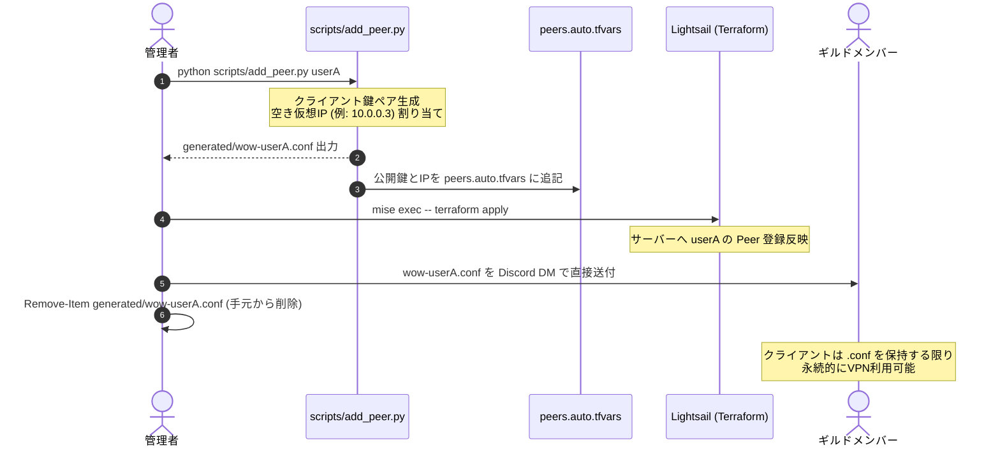

# WoW Private VPN デプロイメントガイド (DEPLOY.md)

本ドキュメントでは、World of Warcraft (WoW) 専用スプリットトンネル VPN の環境構築・デプロイ手順およびギルドメンバーへのトライアル配布手順を定めます。

---

## 1. セキュリティ原則（認証情報・秘密鍵の保護）

1. **AWS 認証情報の非露出**
   - Terraform コード内（`.tf`）や Git 管理対象ファイルに Access Key / Secret Key などのクレデンシャルを絶対に記述しません。
   - 本プロジェクトでは AWS のマネージド IAM 体験および AWS CLI プロファイル（`aws login` によるソーシャル/IdP認証セッション）を利用します。
2. **Terraform ステートファイルの隔離**
   - `terraform.tfstate` には構築されたリソースのIPアドレスや属性が含まれるため、`.gitignore` により Git リポジトリへのコミットを禁止しています。
3. **WireGuard 秘密鍵の個別管理**
   - サーバー秘密鍵およびクライアント秘密鍵（`PrivateKey`）はリポジトリに保存しません。
   - クライアント用設定（`wow-<member>.conf`）はメンバーごとに個別生成し、Git を介さず Discord の 1対1 ダイレクトメッセージ等のセキュアチャネルで個別に配布します。

---

## 2. 前提条件と環境準備

- **direnv & mise**: winget 等で導入済み（ツールバージョン管理）
  - 本リポジトリでは `mise.toml` により Terraform 等のツールバージョンが宣言されています。
  - ディレクトリ移動時に `direnv allow` または `mise install` を実行することで、指定バージョン（`terraform 1.16.6`）が自動適用されます。
- **AWS CLI**: v2.x（インストール済み）
- **SSH クライアント**: OpenSSH 等

### AWS 認証セッションの開始
デプロイを行う前に、AWS CLI でセッションを認証します：
```bash
aws login --profile wow-vpn
```
> [!NOTE]
> リポジトリ内の `.envrc` に `export AWS_PROFILE=wow-vpn` が設定されているため、デフォルトプロファイルへの誤適用を防ぎ、Terraform や AWS CLI は常に `wow-vpn` プロファイルを参照します。認証状態は `~/.aws/config` のプロファイル設定に基づき、本プロジェクトの選択されたリージョン（東京: `ap-northeast-1`）が使用されます。

---

## 3. インフラ構築手順 (Terraform)

### ステップ 1: 設定値の確認（必要に応じてカスタマイズ）
`terraform/` ディレクトリに移動します：
```bash
cd terraform
```
デフォルト設定（東京 + オレゴン構成、`nano_3_0` プラン: $3.50/月）から変更する場合は、`terraform.tfvars.example` をコピーして `terraform.tfvars` を作成します（`terraform.tfvars` は `.gitignore` によりコミット対象外です）：
```bash
cp terraform.tfvars.example terraform.tfvars
```

### ステップ 2: 初期化 & 変更計画のレビュー
```bash
terraform init
terraform plan
```
- **レビューポイント**:
  - `aws_lightsail_instance.tokyo`: 東京（入口）インスタンスが意図したプラン・リージョンで作成されるか
  - `aws_lightsail_static_ip`: 静的IPが確保されアタッチされるか
  - `aws_lightsail_instance_public_ports`: 開放ポートが `51820/UDP` および `22/TCP` のみになっているか

### ステップ 3: 反映 (デプロイ)
```bash
terraform apply
```
プロンプトが表示されたら内容を確認し `yes` を入力します。

デプロイ完了後、ターミナルに以下のような出力（Outputs）が表示されます：
```text
Outputs:
tokyo_instance_name      = "wow-vpn-tokyo"
tokyo_static_ip          = "52.196.xxx.xxx"
tokyo_wireguard_endpoint = "52.196.xxx.xxx:51820"
```

---

## 4. サーバーの自動初期化 (起動時オプション / SSH不要)

本構成では、Lightsail の起動スクリプト（`user_data`）により以下がインスタンス起動時に**完全自動で実行**されます。手動での SSH ログインや設定コマンドの実行は不要です：
- パッケージインストール（`wireguard`, `iptables`, `iptables-persistent`, `curl`, `jq`）
- Linux カーネルの IP フォワーディング有効化
- サーバー鍵ペアの配置および `/etc/wireguard/wg0.conf` の自動生成（登録Peer含む）
- WireGuard サービスの起動 & OS 起動時自動立ち上げ（`systemctl enable --now wg-quick@wg0`）
- Discord Webhook への起動完了通知 & 定期レポート用 cron の登録

> [!NOTE]
> 通常運用時はポート 22（SSH）がファイアウォールで完全に閉鎖されており、インターネットからの不正ログイン・攻撃のリスクがありません。

---

## 5. ギルドメンバーのトライアル追加・配布手順

管理者の手元環境で個別設定を安全に発行し、Git に秘密鍵を残さずメンバーへ配布するライフサイクルです。



### ステップ 1: 設定ファイルの生成
ローカル端末のプロジェクトルートで以下を実行します：
```bash
# 書式: python scripts/add_peer.py <メンバー名> [IP末尾番号 (2〜254)]
python scripts/add_peer.py player1
```
- `generated/wow-player1.conf`（秘密鍵入り配布用設定）が手元に1ファイルだけ生成されます。
- `terraform/peers.auto.tfvars` にメンバー名・公開鍵・仮想IPが自動追記されます。

### ステップ 2: サーバーへの反映
```bash
cd terraform
mise exec -- terraform apply
```
- 変更差分を確認し、`yes` で適用します。
- サーバーが新しい Peer 設定を読み込み、即座に通信可能になります。

### ステップ 3: メンバーへの安全な配布
- `generated/wow-player1.conf` を Discord の 1対1 ダイレクトメッセージ等のセキュアなチャネルでメンバーへ直接送付します。

### ステップ 4: 手元ファイルの安全な削除
送付完了後、手元の秘密鍵ファイルを削除します：
```powershell
Remove-Item generated/wow-player1.conf
```
- クライアント用秘密鍵はメンバー端末にのみ存在し、管理者の手元や Git リポジトリには残りません。
- メンバー側でファイルを保持している限り永続的に利用可能です（紛失時は `peers.auto.tfvars` から削除し、再発行します）。
   ```bash
   cat /etc/wireguard/clients/wow-player1.conf
   ```
2. **配布方法**:
   - Discord の 1対1 ダイレクトメッセージまたは暗号化共有を用いて対象メンバーに直接送信します。
   - **注意**: 全体チャットや Git リポジトリへの貼り付けは絶対に行わないでください。

### ステップ 3: クライアント側の接続確認
1. クライアントに [WireGuard 公式クライアント](https://www.wireguard.com/install/)（Windows版）をインストールしてもらいます。
2. 配布された `wow-player1.conf` を WireGuard クライアントにインポートします。
3. 「有効化（Activate）」をクリックします。
4. World of Warcraft を起動し、通常通りログインできること、レイテンシ（RTT）が安定していることを確認します。

---

## 6. インフラ破棄・クリーンアップ手順

トライアル終了時やインスタンスを停止・リセットしたい場合は、以下を実行します：
```bash
cd terraform
terraform destroy
```
確認プロンプトに `yes` を入力すると、Lightsail インスタンスおよび静的IPが安全に削除され、以降の課金が停止します。
