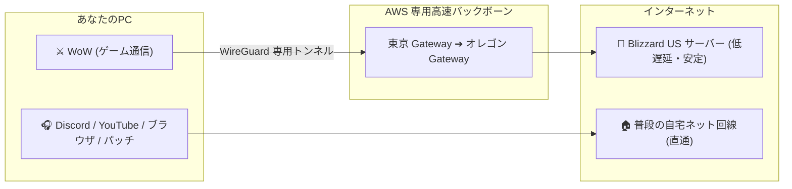

# ⚔️ WoW Private VPN (World of Warcraft US 専用プライベートVPN)

> **日本から北米 (US) サーバーへのラグ・パケロスを極限まで減らし、快適にレイドや Mythic+ を遊ぶためのプライベートゲーミング VPN**  
> **Author**: Gada

---

## 📌 これってなに？ どんなメリットがあるの？

日本のプロバイダ回線からアメリカの World of Warcraft (WoW) サーバーへ接続すると、太平洋を渡る途中でパケット詰まりや遅延（ラグ）が発生しがちです。

本プロジェクトは、Amazon Web Services (AWS) の専用高速バックボーンを利用して、**あなたの PC と WoW サーバー間を最短・最速ルートで直結する専用ネットワーク** です。

### ✨ 主な特徴

1. **⚡ ラグ・パケットロスの低減 (Ping 130〜140ms 台で安定)**
   - 一般の混雑した海底ケーブル網を避け、AWS のグローバル専用ネットワークを優先通過します。
2. **🎧 普段のネット利用を邪魔しない「スプリットトンネル」**
   - **WoW のゲームパケットだけ** を VPN に通します。
   - Discord のボイスチャット、YouTube、ブラウザ閲覧、Steam、大型パッチのダウンロード等は **普段の自宅回線（最速）のまま** 維持されます。
3. **🛡️ ギルド専用の固定 IP (安心・安全)**
   - 市販の VPN（NordVPN や Mudfish 等）のように、不特定多数のユーザーや怪しい BOT 業者と同じ IP を共有しません。
   - Blizzard のセキュリティ判定に引っかかりにくく、アカウントロックの心配がありません。

---

## 🚀 使い方 (カンタン 3 ステップ！)

事前の面倒なネットワーク設定は一切不要です。**所要時間 約 1 分** で利用開始できます。

### ステップ 1: 無料アプリ「WireGuard」をインストール
WireGuard 公式サイトから、お使いの OS に合わせたインストーラーをダウンロードして入れます：
- [WireGuard 公式ダウンロードページ (Windows / Mac)](https://www.wireguard.com/install/)

### ステップ 2: Gada から届いた設定ファイルを読み込む
1. Gada から Discord の個人 DM で送られてくる **`wow-あなたの名前.conf`** というファイルを PC に保存します。
2. WireGuard アプリを起動し、ウィンドウ内にそのファイルを **ドラッグ＆ドロップ**（または「トンネルをファイルから追加」）します。

### ステップ 3: 「有効化」をクリック！
1. リストに追加された接続名を選び、**「有効化」** ボタンを押します。
2. ステータスが「有効」になり、データ送受信のメーターが動けば準備完了！
3. あとは普段通り Battle.net から WoW を起動して遊ぶだけです。

---

## ❓ よくある質問 (FAQ)

### Q. ゲームをしていない時もオンのままで大丈夫？
**A. 大丈夫です！**  
WoW のサーバー宛て以外の通信（ウェブサイト、動画、Discord 等）は VPN を一切通りません。つけっぱなしにしていても普段の PC 利用に影響はありません。

### Q. Discord の通話が遅れたり、YouTube が止まったりしない？
**A. まったく影響ありません。**  
本 VPN は「ゲームパケット専用」に設計されています。動画や Discord はあなたのご自宅のネット回線をそのまま使うため、画質が落ちたり遅延が増えたりすることはありません。

### Q. チートツール扱いされてゲームが BAN されたりしない？
**A. BAN の心配はありません。**  
Blizzard の利用規約では、遅延改善目的の VPN 接続（Mudfish や ExitLag 等と同様）は禁止されていません。また、ゲームファイルやメモリを改ざんするソフトウェアではないため、Blizzard のアンチチート（Warden）に不正検知されることもありません。

### Q. 他のメンバーに自分の PC の中身を見られたりしない？
**A. 一切見られません。**  
サーバー側で「メンバー間の直接通信を完全にブロック（クライアント分離）」する設計になっているため、同じ VPN を使っている他のメンバーからあなたの PC 内のファイルや共有フォルダを覗くことは不可能です。

### Q. 利用料金はかかる？
**A. ギルドメンバーは無料です。**  
サーバーのインフラ費用（AWS Lightsail）は管理者（Gada）が運用しています。

---

## 🛠️ 管理者・技術者向けドキュメント

システムの構築、インフラコード、運用手順、セキュリティアーキテクチャの詳細は以下を参照してください：

- 🚀 **構築とデプロイ手順書**: [DEPLOY.md](DEPLOY.md)
- 🔧 **日常の運用・保守・トラブルシューティング**: [MAINTENANCE.md](MAINTENANCE.md)
- 🛡️ **セキュリティアーキテクチャ & 設計思想**: [SECURITY.md](SECURITY.md)

---
*Created with ❤️ for WoW US Players by Gada*
